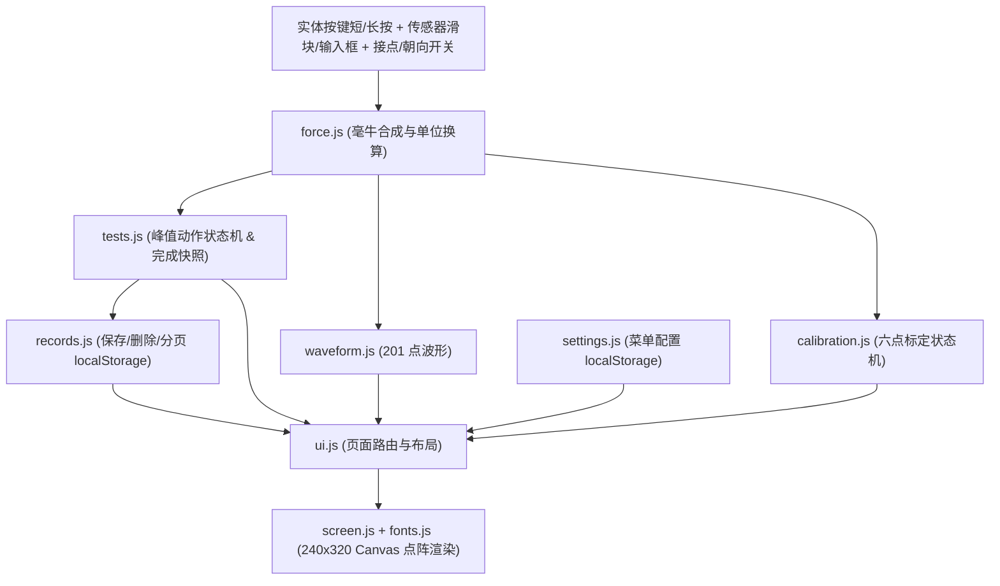

# 嵌入式 LCD 网页模拟器模块架构与点阵提取指南

本参考文档提炼自 QW-603 (`N32G455_TensileTesting`) 的 `拉力计网页互动演示计划.md` 与 `package-demo.ps1`。

---

## 1. 目录结构与单向数据流

```text
html/
├── index.html              # 仪器机壳外观、240×320 Canvas 画布、5 个实体按键、右侧传感器滑块/力值输入框/接点与朝向开关
├── js/
│   ├── fonts.js            # 由 tools/extract_fonts.mjs 从固件 font_*.c 自动生成
│   ├── screen.js           # 240×320 逻辑帧缓冲、RGB565 颜色转换、点阵字绘制、矩形与裁剪折线、180° 翻转
│   ├── force.js            # 滑块/锁定输入合成、零点死区回滞、重力加速度与单位换算 (N / kgf / lbf / ozf)
│   ├── waveform.js         # 201 点滚动/固定窗口与动态量程缩放
│   ├── tests.js            # 实时 10s 峰值及压缩/拉伸/插拔/接点保持/破断/按键测试状态机
│   ├── settings.js         # 与固件 AppSettingsData 完全同构的配置项 + localStorage 持久化
│   ├── records.js          # 记录保存去重、列表 5 条分页、正反序、单条删除与清空 + localStorage
│   ├── calibration.js      # 密码校验、大小量程/拉压方向选择、六点稳定窗口采集与提交
│   └── ui.js               # 页面状态机与像素级绘制（只读快照、只投事件）
└── tools/
    └── extract_fonts.mjs   # 从 C 源码提取点阵字模的 Node.js 脚本
```



---

## 2. 从固件 C 字库自动提取点阵 (`extract_fonts.mjs` 核心思路)

嵌入式字库通常包含 `glyphs[]` 描述表（含 Unicode 码点、`width`、`height`、`advance`、`dwidth`、`x_offset`、`y_offset`、`bitmap_offset`）和 `bitmaps[]` 字节数组：

1. 使用正则表达式匹配 `font_*.c` 中的 `static const uint8_t ..._bitmaps[] = { ... }`，提取所有十六进制字节转为 `Uint8Array`（或 Base64 字符串以减小体积）。
2. 匹配 `static const ..._glyph_t ..._glyphs[] = { ... }`，解析每行的 `{ codepoint, width, height, ... }`。
3. 输出为可直接由 `<script src="js/fonts.js"></script>` 加载的 JS 对象，确保网页上的每一个汉字、数字和符号与实物 LCD 屏幕逐像素一致。

---

## 3. 传感器外设的网页控件映射规范

1. **连续载荷模拟（竖向滑块 + 数值保持输入框）**：
   - 滑块范围覆盖 `[-FS, +FS]`，松手可配置自动回零或保持；
   - 数值输入框支持直接键入精确力值（用于测试公差边界和六点标定稳定采点），写入后进入“锁存保持”状态，直到用户点击“释放/回零”或再次拖动滑块。
2. **开关量/外部中断模拟（如 `PA11 / INSER` 接点信号）**：
   - 用网页上的拨动开关或点动按钮模拟，内部经过与固件一致的 `10 ms` 去抖状态机，生成上升沿/下降沿事件送入接点保持测试模块。
3. **重力感应翻转模拟**：
   - 提供“正向 / 反向”切换开关，仅当系统菜单中“屏幕方向”设为“自动”时生效，触发 Canvas 180° 旋转重绘。
