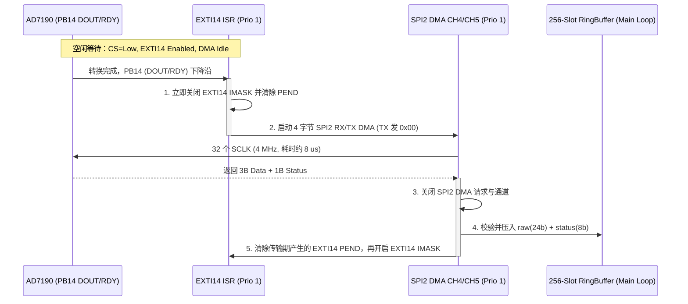

# AD7190 寄存器配置、2402 Hz 时序与 EXTI+DMA 状态切换参考

本参考文档提炼自 QW-603 (`N32G455_TensileTesting`) 的 `drv_ad7190.c/.h` 与 `SPI+DMA配置参考.md`。

---

## 1. 常用寄存器地址与输出数据率 (ODR) 计算

AD7190 内部标称时钟 $f_{\text{CLK}} = 4.92\text{ MHz}$。当 `CHOP = 0`（斩波关闭）时，输出数据率公式为：
$$f_{\text{ODR}} = \frac{4.92\text{ MHz}}{1024 \times \text{FS}}$$

| `FS` 配置值 (`MODE[9:0]`) | 标称输出数据率 ($f_{\text{ODR}}$) | 单帧间隔 | 典型应用场景 |
| :---: | :---: | :---: | :--- |
| `2` | **2402.3 Hz** | $416\ \mu\text{s}$ | 高速破断/按键瞬态力值峰值捕捉（QW-603 默认） |
| `4` | **1201.2 Hz** | $832\ \mu\text{s}$ | 中高速动态拉压测试 |
| `5` | **960.9 Hz** | $1.04\text{ ms}$ | 接近 1 kHz 标准采样 |

### 核心寄存器配置组合（惠斯通电桥传感器推荐基线）
- **`GPOCON` (`0x28`, 8-bit)**：`AD7190_GPOCON_BPDSW (1 << 6)` —— 闭合桥路电源低端开关。
- **`CONF` (`0x10`, 24-bit)**：
  - 差分通道：`AD7190_CH_AIN3_AIN4`
  - 增益：`AD7190_GAIN_128 (0x07)`（匹配 $2.0\text{ mV/V}$ 传感器）
  - 极性与缓冲：`UNIPOLAR = 0`（双极性偏移二进制码，`0x800000` 为零点）、`BUF = 1`（开启输入缓冲）、`REFSEL = 0`（`REFIN1`）
- **`MODE` (`0x08`, 24-bit)**：
  - `MODE_SEL = 0`（连续转换）、`DAT_STA = 1`（24-bit 数据后附带 8-bit `STAT` 寄存器）、`CLKSRC = 2`（内部时钟）、`SINC3 = 0`（使用 Sinc4 滤波器）、`FS = 2`。

---

## 2. `DOUT/RDY` 引脚在 EXTI 与 SPI DMA 间的精确切换时序



---

## 3. 中断内防重入与防伪触发代码范式

```c
/* 1. EXTI14 ISR：触发采样 */
void ad7190_rdy_irq_handler(void)
{
    if (EXTI_GetITStatus(EXTI_LINE14) == RESET)
    {
        return;
    }
    EXTI_ClrITPendBit(EXTI_LINE14);

    if ((s_continuous_active == 0U) || (s_dma_busy != 0U))
    {
        return;
    }
    /* 确认引脚当前确实处于低电平就绪态 */
    if (GPIO_ReadInputDataBit(GPIOB, GPIO_PIN_14) != Bit_RESET)
    {
        return;
    }

    s_rdy_irq_count++;
    /* 关键：启动 SPI 时钟前先屏蔽 EXTI，防止 MISO 数据位翻转触发中断风暴 */
    EXTI->IMASK &= ~EXTI_LINE14;
    EXTI_ClrITPendBit(EXTI_LINE14);

    s_dma_start_tick = PlatformTime_GetMs();
    (void)ad7190_spi_dma_start(NULL, s_rx_dma_buf, 4U, 0x00U, 1U);
}

/* 2. DMA1 CH4 RX 完成 ISR：入队并恢复 EXTI */
void ad7190_dma_rx_irq_handler(void)
{
    if (DMA_GetIntStatus(DMA1_INT_TXC4, DMA1) != RESET)
    {
        ad7190_spi_dma_stop();
        s_dma_complete_count++;

        /* 拼装 24-bit 样本 + 1B Status 并压入无锁 RingBuffer */
        ad7190_push_frame(s_rx_dma_buf);

        /* 关键：先清除 MISO 翻转遗留的 EXTI 挂起位，再重新打开 EXTI 掩码 */
        if (s_continuous_active != 0U)
        {
            EXTI_ClrITPendBit(EXTI_LINE14);
            EXTI->IMASK |= EXTI_LINE14;
        }
    }
}
```
