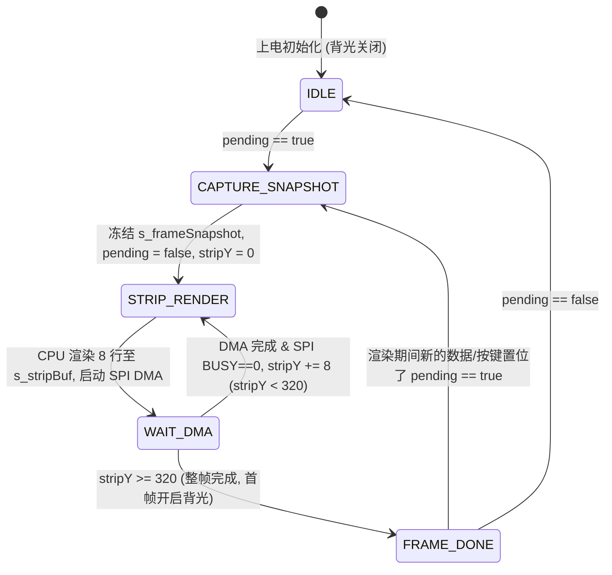

# 帧一致性快照 (`PageSnapshot`)、表驱动菜单与列表交互状态机参考

本参考文档提炼自 QW-603 (`N32G455_TensileTesting`) 的 `app_ui_home.c`、`app_i18n.c` 与 `软件架构优化与重构方案.md`。

---

## 1. 条带渲染器的帧快照合并模型 (`active / pending / nextY`)



```c
typedef struct
{
    uint8_t  pageId;
    uint8_t  langId;
    uint8_t  menuCursor;
    uint8_t  menuScrollTop;
    uint8_t  bottomToastType;  /* NONE / SAVE_OK / SAVE_FAIL / FULL */
    char     mainForceText[16];
    char     subPeak1Text[16];
    char     subPeak2Text[16];
    uint8_t  judgeState;       /* NONE / MINUS_NG / OK / PLUS_NG / ERR */
} UiFrameSnapshot;
```

---

## 2. 驻留 Flash 的表驱动菜单描述符 (`const MenuItem`)

```c
typedef enum
{
    MENU_ITEM_SUBPAGE = 0,  /* 进入子菜单页 */
    MENU_ITEM_ENUM_CYCLE,   /* 枚举项循环切换 (如单位、采样率、语言) */
    MENU_ITEM_INT_STEP,     /* 整数步进调节 (如归零时间 1~9s、公差上下限) */
    MENU_ITEM_READONLY,     /* 只读展示 (如额定量程、固件版本) */
    MENU_ITEM_ACTION        /* 触发确认动作 (如恢复出厂设置) */
} MenuItemType;

typedef struct
{
    uint16_t     titleStrId;              /* 多语言字典 ID */
    MenuItemType type;
    uint8_t      targetPageOrParamId;
    int32_t      minVal;
    int32_t      maxVal;
    int32_t      stepVal;
    bool       (*isEnabled)(void);        /* 如自动归零关闭时，归零时间返回 false 显示 "---" */
    void       (*formatValue)(char *buf, uint16_t cap);
} MenuItemDesc;
```

---

## 3. 历史记录列表的“阅读模式 ↔ 单条删除模式”五态交互范式

针对只有 5 个按键（`ZERO`, `UNIT/UP`, `DATA/DOWN`, `MENU/BACK`, `PWR/ENTER`）的仪器，列表页（每页 5 条）采用无冲突双模式状态机：

1. **阅读模式（默认无单条光标）**：
   - `UNIT` / `DATA` 短按：上一页 / 下一页；
   - `DATA` 持续按住 `5 s`（须进入本页松手后重计时）：进入“清空全部记录？”二次确认页；
   - `PWR/ENTER` 短按：若当前有记录，切入**单条选择删除模式**，默认高亮当前页第 1 条；
   - `MENU` 短按：返回上级页面。
2. **单条选择删除模式（带行高亮光标）**：
   - `UNIT` / `DATA` 短按：按屏幕顺序移动单条高亮光标；跨页边界时自动异步加载上一页（选中末条）或下一页（选中首条），到达全局首尾时停住不循环；
   - `PWR/ENTER` 短按：锁定当前选中记录的稳定主键 `{generation, recordId}`（**绝不锁定易变的显示行号**），进入“删除本条记录？”二次确认弹窗；
   - `MENU` 短按：退出删除模式，回到无光标阅读模式。
3. **单条删除二次确认与删除后光标落点**：
   - `MENU` 取消：回到原选中行；
   - `PWR/ENTER` 确认：提交异步删除（及可能的稀疏扇区整理）；
   - **删除完成后光标落点**：若全部记录已删空，退回阅读模式显示“无记录”；若删除的是最后一页的唯一一条，自动退回上一页并选中末条；否则继续留在选择模式并选中当前页第一条，方便用户连续删除多条记录。
